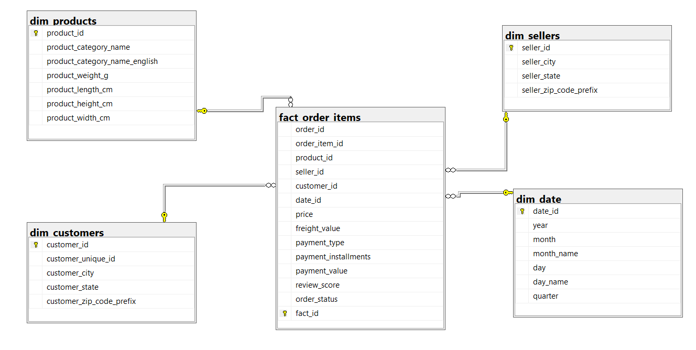
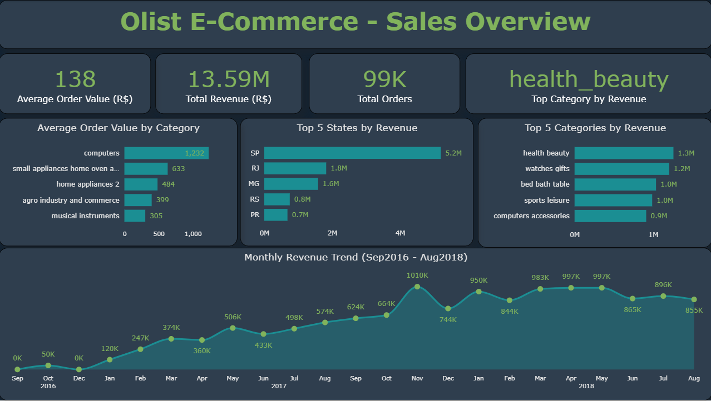
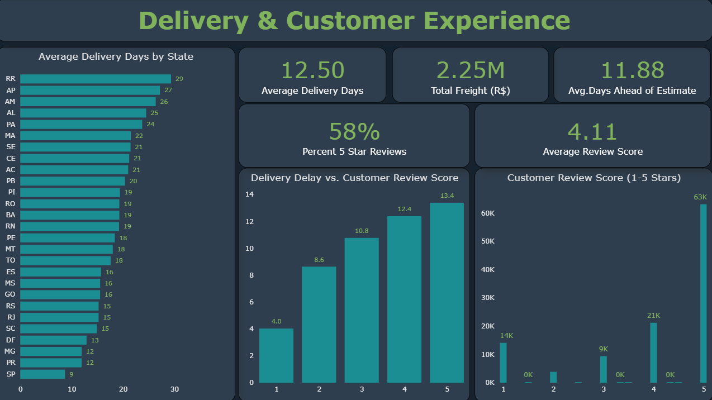
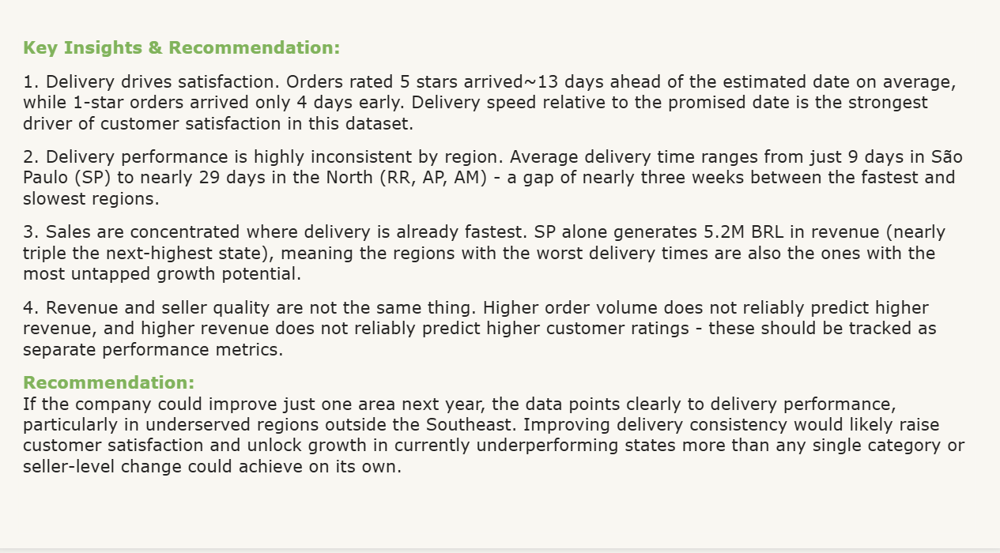

# 📊 Olist Brazilian E-Commerce: End-to-End Data Analysis

From raw, messy CSV exports to a cleaned SQL Server data model, 12 business-driven SQL queries, and a 3-page Power BI dashboard, built the way a real analyst would approach a new dataset on day one.

---

## 📌 Project Overview

Olist is a Brazilian marketplace that connects small independent sellers to major online storefronts, handling everything from listings to logistics. This project uses Olist's public dataset (~100K orders, 2016–2018) to answer a simple question a manager might actually ask:

"Where is the business doing well, and where should we focus next year?"

The project covers the full analyst workflow: cleaning raw data in SQL Server, building a proper Star Schema, writing business-focused SQL queries, and turning the findings into a Power BI dashboard.

---

## 🧰 Tools Used

| Tool | Purpose |
|---|---|
| SQL Server / SSMS | Data cleaning, modeling, and analysis |
| Power BI Desktop | Dashboard and DAX measures |
| DAX | Calculated measures (revenue, delivery time, satisfaction) |

---

## 📂 Repository Structure

```
├── data_cleaning.sql       -- Raw data cleanup, deduplication, integrity checks
├── data_modeling.sql       -- Star Schema build (fact + dimension tables)
├── sql_analysis.sql        -- 12 business questions, answered in SQL with insights
├── erd_diagram.png         -- Star Schema relationship diagram
├── dashboard_screenshots/  -- Power BI dashboard pages
└── README.md
```

---

## 🧹 1. Data Cleaning

Nine raw tables were imported as-is into SQL Server, then audited and cleaned. The goal wasn't just "remove nulls." It was distinguishing real data problems from normal business behavior.

Key issues found and fixed:

- **261,831 duplicate rows** in the geolocation table (26% of the table), removed using ROW_NUMBER() + PARTITION BY.
- **Zip codes silently lost leading zeros** on import (09790 became 9790) because the column was typed as INT instead of text. Fixed by converting to VARCHAR and re-padding.
- **A broken header row** in the category translation table. The import wizard misread the header as a data row, throwing off both the row count and the column names.
- **610 products with no category**, flagged as 'unknown' instead of deleted, since dropping them would have silently removed real linked sales data.
- **NULL delivery dates and review comments**, investigated rather than "fixed." Both turned out to reflect real business states (an order that hasn't shipped yet, a customer who rated without commenting), not data errors, so they were left untouched.
- **Referential integrity**, confirmed with LEFT JOIN ... WHERE parent.key IS NULL checks across every foreign key relationship. Zero orphan records found.

📄 Full script with explanations: data_cleaning.sql

---

## 🗂️ 2. Data Modeling: Star Schema

The cleaned tables were rebuilt into a Star Schema: one central fact table surrounded by four dimension tables, so the model would perform well in Power BI and be easy for anyone to follow.

fact_order_items holds price, freight, delivery dates, and review score, linked to:

- dim_customers (99,441)
- dim_products (32,951)
- dim_sellers (3,095)
- dim_date (634), built from scratch since no date dimension existed in the raw data

Because an order can contain multiple items, payment methods, and reviews, the fact table holds 118,310 rows covering 112,650 real items sold. Every relationship was validated in SQL before being confirmed visually in the diagram below.



📄 Full script: data_modeling.sql

---

## 🔎 3. SQL Business Analysis

Twelve questions, scaled from simple descriptive metrics up to multi-table analytical questions, ending with a strategic synthesis question.

⚠️ A modeling detail worth calling out: joining straight onto the fact table risks counting the same order more than once. Revenue metrics in this project handle this with deduplicating CTEs that aggregate at the correct grain before rolling up. Review metrics count each submitted review once, so the 551 orders that received more than one review are counted once per review.

A few of the findings:

| Question | Finding |
|---|---|
| What drives revenue? | Health & Beauty leads in total revenue despite not having the highest unit sales. |
| Does delivery affect satisfaction? | Yes, clearly. 5-star orders arrived ~13 days ahead of schedule on average; 1-star orders only ~4 days ahead. |
| Is delivery consistent nationwide? | No. Average delivery time ranges from ~9 days in São Paulo to ~29 days in the North. |
| Does seller revenue predict seller quality? | No. Review scores among the top 10 sellers by revenue range from 3.34 to 4.34, so sales volume and customer satisfaction are separate metrics. |

Bottom line: delivery performance stands out as the clearest area for improvement, since it is tied to both customer satisfaction and regional inconsistency.

Scope note: revenue figures count every recorded order, including canceled and unavailable ones. Delivered orders alone total 13.22M BRL of the 13.59M BRL recorded.

📄 All 12 questions with queries and full insights: sql_analysis.sql

---

## 📊 4. Power BI Dashboard

A 3-page dashboard, deliberately kept lean: every chart maps directly back to a specific question from the SQL analysis rather than existing just to fill space.

**Page 1: Sales Overview**

Total revenue, orders, and AOV at a glance, plus category, state, and monthly trend breakdowns.



**Page 2: Delivery & Customer Experience**

Delivery time by state, delivery delay vs. review score, and the overall review score distribution. Together, these three charts explain why satisfaction varies.



**Page 3: Key Insights & Recommendation**

A plain-language summary tying the SQL findings together into one strategic recommendation.



---

## 💡 Key Takeaway

If Olist could invest in improving exactly one thing next year, the data points to delivery performance in underserved regions. Delivery speed relative to the promised date is strongly associated with review scores in this dataset: late orders receive 1–2 star ratings 54% of the time, versus 9% for on-time orders. Delivery is also slowest in exactly the regions the company has grown into least, which suggests better logistics outside São Paulo could lift both satisfaction and growth at the same time. That last part is a hypothesis worth testing further, not a proven conclusion.

---

## 👤 About This Project

This project was built end to end: cleaning, modeling, SQL analysis, and dashboarding, as a hands-on demonstration of the full data analyst workflow, using a real, publicly available e-commerce dataset rather than a pre-cleaned sample.

Dataset source: Olist Brazilian E-Commerce Public Dataset (Kaggle)
